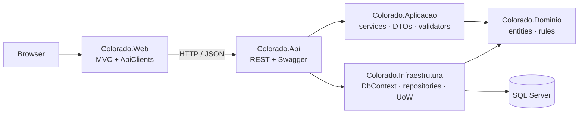

# Colorado — Customer Registry

**English** · [Português](README.pt-BR.md)

[](https://github.com/pablofreire/ColoradoTeste/actions/workflows/ci.yml)

A customer registry built as the solution to a full-stack developer take-home challenge. It is an ASP.NET Core application with two presentation layers over a Clean Architecture core:
- a RESTful Web API that owns persistence;
- an MVC web app that only talks to that API over HTTP.

The domain, code identifiers and UI are in Portuguese, as the challenge required.

## Problem

The challenge asked for customer registration with phone numbers and phone types, validated for Brazilian documents, and exposed both as an API and as a web UI. The solution keeps the two UIs honest about boundaries: the web app has no database access at all, so every rule is enforced once, on the server.

## Key features

- **Domain.** Customers (individual or company) with address and document, phones (composite key customer + number) with type and carrier, and seeded phone types.
- **Brazilian documents.** CPF and CNPJ check digits, including the new **alphanumeric CNPJ** format. Each character counts as `ASCII − 48` in the modulo-11 calculation, and the same algorithm is mirrored in JavaScript for instant feedback.
- **Validation on both sides:**
  - inline client-side validation with no postback;
  - FluentValidation in the application services plus domain invariants on the server;
  - errors come back as a 400 with the error list and are shown inside the open modal.
- **Dynamic form.** Fields, labels and input masks (IMask) change with the person type. The person type is read-only on edit, and the "registered by" user is captured on creation only.
- **Consistent API.** Every response uses one envelope (`sucesso`, `mensagem`, `dados`, `erros`) with proper status codes (200, 201, 204, 400, 404, 500), handled by middleware.

## Tech stack

| Area | Technology |
|---|---|
| Runtime | .NET 6, ASP.NET Core Web API, ASP.NET Core MVC (Razor, Bootstrap 5, plain JavaScript) |
| Data | SQL Server, EF Core (Fluent API configurations, migrations), repository and Unit of Work |
| Validation | FluentValidation, domain invariants |
| Testing | xUnit, NSubstitute, FluentAssertions, SQLite in-memory for repository tests |
| Tooling | Docker Compose, Swagger, GitHub Actions |

## Architecture



- **Layers:** Domain, Application, Infrastructure, API and Web, grouped by solution folders (`01-Presentation` … `04-Infrastructure`, `Tests`).
- **Feature folders:** inside each layer, entity-specific artifacts live in per-feature folders (`Clientes/`, `TiposTelefone/`), and shared building blocks sit at the folder root.
- **Web as a pure client.** A generic HTTP client (`ApiHttpCliente`) centralises serialisation, the envelope and error handling. Thin per-entity clients only know their routes, and server-rendered partial views drive the AJAX screens.
- **Mapping and orchestration:** manual mapping instead of AutoMapper, and application services instead of MediatR. At this size both are more explicit and easier to debug.

## Getting started

Requirements: Docker. The .NET SDK is optional; the build runs with SDK 6 or later.

```bash
cp .env.example .env          # then set MSSQL_SA_PASSWORD
docker compose up --build
```

- API and Swagger: http://localhost:5000/swagger
- Web app: http://localhost:5002

The API applies migrations on startup and retries while SQL Server starts.

### Running outside Docker

```bash
docker compose up -d sqlserver   # SQL Server on localhost,1434
dotnet user-secrets set "ConnectionStrings:ConexaoPadrao" \
  "Server=localhost,1434;Database=ColoradoDb;User Id=sa;Password=<your MSSQL_SA_PASSWORD>;TrustServerCertificate=True;" \
  --project src/Colorado.Api
dotnet run --project src/Colorado.Api    # http://localhost:5189/swagger
dotnet run --project src/Colorado.Web    # ApiBaseUrl points to :5189 in Development
```

`dotnet ef migrations add` works without a database. `dotnet ef database update` reads the connection string from the `ConnectionStrings__ConexaoPadrao` environment variable.

## Configuration

| Setting | Where | Purpose |
|---|---|---|
| `MSSQL_SA_PASSWORD` | `.env` (git-ignored) | SQL Server `sa` password for Docker Compose |
| `ConnectionStrings:ConexaoPadrao` | user-secrets or environment | API database connection; the design-time EF factory reads the environment variable |
| `ApiBaseUrl` | `appsettings*.json` or environment | Address of the API used by the web app |

No password is committed.

## API

| Method | Route | Description |
|---|---|---|
| GET | `/api/clientes` | Paged list, filters `nome` and `documento` |
| GET | `/api/clientes/{codigo}` | Customer with phones |
| POST | `/api/clientes` | Create |
| PUT | `/api/clientes/{codigo}` | Update |
| DELETE | `/api/clientes/{codigo}` | Delete |
| GET/POST/PUT/DELETE | `/api/tipos-telefone[/{codigo}]` | Phone types |

## Running tests

```bash
dotnet test
```

93 tests, one project per layer:

| Project | Tests | Scope |
|---|---|---|
| `Colorado.Dominio.Testes` | 34 | Entity invariants, CPF/CNPJ validation |
| `Colorado.Aplicacao.Testes` | 30 | Validators, mappers, service flows |
| `Colorado.Infraestrutura.Testes` | 10 | Repositories on SQLite in-memory: filters, paging, includes, composite key, seed |
| `Colorado.Web.Testes` | 11 | MVC controllers with mocked API clients |
| `Colorado.Api.Testes` | 8 | API controllers with mocked services |

## Roadmap

- Move from .NET 6, which is out of support, to .NET 8 LTS.
- Run the repository tests against SQL Server with Testcontainers in addition to SQLite.

## License

[MIT](LICENSE)
